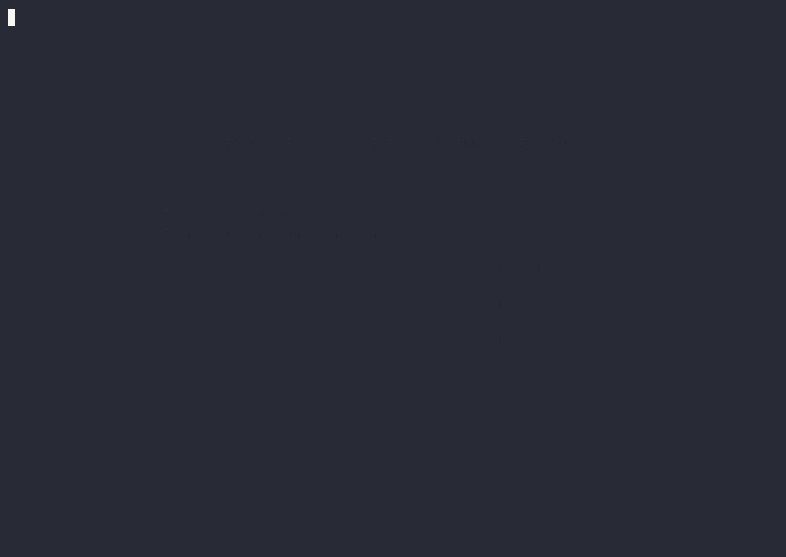

# Module 5 — terminal

Native terminal port of the Module 5 pentomino game (there's also a web
version in Three.js). Same pentominoes, same 20 levels, the same count of
2339 unique solutions, and **challenge codes interchangeable with the web
version**.

No X11, no graphical environment, nothing to compile or install: it's Python
3 with pure standard library. Works on Linux and macOS over SSH, in tmux, or
on a bare console.



## Play

```bash
./module5
```

That's it. The launcher finds a Python 3 (≥ 3.8) and starts.

If you'd rather skip the launcher:

```bash
python3 -m m5
```

### Single file

To carry it to another machine, copying **one** file is enough. It's built
with `zipapp`, also from the standard library:

```bash
./build.sh
```

That produces `m5.pyz` (~42 KB), executable and self-contained:

```bash
./m5.pyz
```

Copy it to any Linux or macOS with Python 3 and it runs as-is — no
`pip install`, nothing to compile. If `m5.pyz` sits next to the launcher,
`./module5` uses it automatically.

## Controls

Everything plays with the keyboard. The mouse works if the terminal supports
it, but it's never required.

| Action | Keys |
| --- | --- |
| Move the piece / cursor | `←↑↓→` or `WASD` |
| Pick a piece | `1`-`9`, `0`, `-`, `=` (F I L N P T U V W X Y Z) or `TAB` |
| Rotate / Flip | `R` / `F` |
| Place | `Enter` or `Space` |
| Take back a placed piece | `Backspace` over it, or its same key |
| Reset the board | `X` |
| Board zoom | `+` / `_` (Shift-`=` / Shift-`-`) or the mouse wheel |
| Help | `?` |
| Back / cancel | `Esc` |
| Quit | `Ctrl-C`, or `q` from the menu |

With the mouse: click places or takes back, right-click cancels the
selection, and in the editor you can drag to paint.

## Modes

**01 — Classic.** Fill the 6×10 board with all 12 pieces. The score is time.
Each solution is recorded in canonical form (invariant to 180° rotation and
board mirrors) and can't repeat: there are **2339 unique solutions** (9356
counting symmetries) to discover. It's the exact same canonicalization as
the web version, so the count means the same thing in both.

**02 — Shapes.** 20 levels of increasing difficulty (1 to 12 pieces). The
target silhouette shows in the side panel, compressed with half-blocks. Each
level unlocks the next.

**My challenges.** Paint your own silhouette on a 6×10 grid (multiples of 5,
up to 60 cells) and an exact-cover solver checks it has a solution before
letting you save it. Each challenge exports as a text code:

```
M5.eyJuIjoiQ3J1eiBQcnVlYmEiLCJyIjozLCJjIjozLCJiIjoiZVFBPSJ9
```

That format is **byte-for-byte the same** as the web version's: a challenge
created in the terminal imports into the browser and back. The code is
re-verified on import. No hints during play, just like the physical puzzle.

### Board size

The board **scales to the available space**: it picks the largest cell that
fits the terminal (from 2×1 up to 8×4 characters) and rescales only when the
window is resized, without restarting the game. A 60-cell board stays at
medium cells — stretching it further spaces the letters out enough that the
pieces stop reading as a single shape — while the small silhouettes in the
early levels grow more, so they don't get lost in the middle of the screen.

That automatic choice can be overridden with **`+` and `_`** (on a US
keyboard, Shift-`=` and Shift-`-`; without Shift those keys already pick
pieces Y and Z) or with the **mouse wheel**, like the pinch gesture in the
web's ASCII view. Manual zoom goes further than the automatic one, but it
always clamps to what fits on screen, so zooming in too far never overflows
the board. It also works in the challenge editor, is remembered across
sessions, and if zooming out lands you back exactly on the scale the game
would've picked on its own, it returns to automatic mode and keeps adapting
as you resize.

## Settings

Under `SETTINGS`: language (Spanish / English, detected from `LANG`), theme,
mouse, 5 save-game slots, and progress reset.

### Themes

| Theme | |
| --- | --- |
| `neon` | Neon on black (default): each piece is a colored tile |
| `ascii` | Green phosphor, plain text — the equivalent of the web's ASCII theme |
| `blueprint` | Technical blueprint in blue |
| `mono` | No color, for plain terminals |

The game detects what the terminal supports and adapts: 24-bit color if
`COLORTERM=truecolor`, 256 colors, 16 colors, or no color. Respects
`NO_COLOR`.

Glyphs adapt too. Arrows and the middle dot have "ambiguous" width, and some
terminals render them at double width, which would throw off the box
borders; on consoles where that's likely (`TERM=linux`, `dumb`) the game
uses an ASCII glyph set. Can be forced with `--ascii`.

## Options

```
--lang {es,en}                  language
--theme {neon,ascii,blueprint,mono}
--ascii                         ASCII-only characters
--no-mouse                      don't enable the mouse
--no-color                      no color
--save-dir DIR                  where to save progress
```

## Where progress is saved

- Linux: `$XDG_DATA_HOME/module5/save.json` (or `~/.local/share/module5/`)
- macOS: `~/Library/Application Support/module5/save.json`

A single JSON, written atomically (temp file + `rename`) so it can't end up
corrupted if the process dies mid-write. `MODULE5_HOME` or `--save-dir` move
it elsewhere.

## Tests

```bash
python3 tests/test_smoke.py    # logic and drawing, no terminal
python3 tests/test_pty.py      # integration on a real pty
```

`test_smoke.py` plays full games (solves the board with the solver and
places pieces one by one through the real game path), checks that all 20
levels are solvable, that repeated and symmetric solutions get rejected,
that codes match the web version's, and that no screen blows up across 9
sizes × 4 themes × 4 color modes × 2 glyph sets, plus 4000 random input
events.

`test_pty.py` boots the game in a real pseudo-terminal and checks raw mode,
the alternate screen, the mouse, `SIGWINCH`, and that the terminal is left
exactly as it was on exit.

## Structure

| | |
| --- | --- |
| `m5/pieces.py` | the 12 pentominoes, orientations, palette, and keys |
| `m5/levels.py` | the 20 levels + the classic board |
| `m5/solver.py` | exact cover with bitmasks, region pruning, and cancellation |
| `m5/term.py` | raw mode, alternate screen, diff rendering, keyboard, and mouse |
| `m5/glyphs.py` | the two glyph sets (Unicode / ASCII) |
| `m5/theme.py` | the four themes |
| `m5/ui.py` | frames, board, tray, silhouettes, text field |
| `m5/game.py` | game state, ghost piece, clock, canonical solution |
| `m5/screens.py` | menu, levels, game, editor, settings, modals |
| `m5/app.py` | screen stack, main loop, completion |
| `m5/store.py` | persistence and challenge codes |

### Implementation notes

**Doesn't use `curses`.** 24-bit color was needed for the neon palette, and
a custom buffer only flushes the cells that changed: an idle frame sends
**zero bytes**, which matters over SSH and keeps CPU use at nothing. Each
frame is also wrapped in "synchronized output" (DEC 2026), so no tearing
shows while repainting.

**The solver runs on the main thread.** With the GIL, a thread wouldn't
help: the solver hands control back to the renderer every so many nodes via
a callback, which spins the spinner and allows canceling with `Esc`.
Verifying the full 6×10 — the worst case — takes ~1.4 s.

**On exit, the terminal is left exactly as it was**, even if the game
crashes or gets suspended with `Ctrl-Z`: `Terminal` is a context manager and
hooks `SIGTSTP`/`SIGCONT` to restore and redo raw mode.

## Credits

**Concept and development** — [Victor Crespo](https://3dvic.com)

If this was useful, a coffee is always welcome: [ko-fi.com/vicc3d](https://ko-fi.com/vicc3d)

## License

MIT — see [LICENSE](LICENSE).
